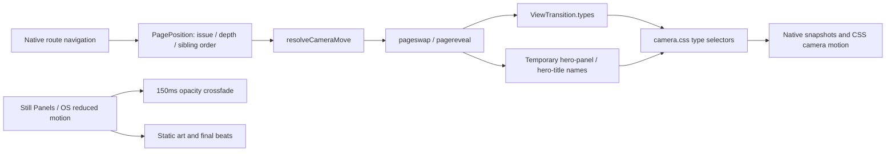

# DMNS Field Notes

An independent, static multi-page concept redesign of the Denver Museum of Nature & Science: a field notebook with comic panels, native browser navigation, and a persistent plain-language visitor strip.

## Run

Requires Node.js 22 or newer (Node 24 used for verification).

```sh
npm ci
npx playwright install chromium firefox webkit
npm run dev
```

Open the printed Local URL. The default is `http://127.0.0.1:4173`. If that port is occupied:

```sh
PORT=4187 npm run dev
```

`npm run dev` builds the static output and serves it. After editing source, run `npm run build` and reload; there is intentionally no runtime bundler or development framework. To serve an existing build, use `npm run serve`.

## Verify

```sh
npm run check       # strict types, ESLint, unit tests, build, budgets, contrast,
                    # internal links, rendered reading order, browser/axe tests
npm run audit       # Lighthouse mobile: Cover, Halls, Prehistoric Journey
npm run record      # 60-second keyboard walkthrough, saved beside this repository
npx tsx scripts/browser-report.ts
```

The browser suite opens its own temporary server on port 4188. It verifies Chromium comprehensively and runs Firefox and WebKit smoke tests. Physical-device and field-metric limits are recorded in `docs/browser-support.md` and `docs/verification.md`.

All 26 routes render complete HTML. Tests separately load every route with JavaScript disabled. Static markup is also axe-audited with application modules suppressed, so the auditor can execute without upgrading the site.

## Build and content date

```sh
npm run build
BUILD_DATE=2026-10-30 npm run build
```

The default editorial snapshot is `content/site.json → asOf` (`2026-10-16`). Set `BUILD_DATE=YYYY-MM-DD` for a different deterministic build date. Expired notices are omitted, and exhibition status is computed from that date. A static host must rebuild when facts or schedules change. The persistent strip additionally checks the current Denver date/time in the browser; Friday evening hours remain explicitly unconfirmed because the supplied fact is “most Fridays.”

Content files are validated at build time. Missing approved information is rendered as **TODO: confirm with DMNS**. No invented collection facts, programs, staff, prices, or events fill the gaps.

## Architecture

Strict TypeScript compiles with `tsc` to native ES modules. `scripts/build.ts` renders typed template literals from validated JSON into `dist/<route>/index.html`. Custom elements upgrade light DOM; no client router intercepts links. A small classic preference script runs before paint. Only local fonts and assets are requested.



| Route example | Position | Navigation example | Camera |
|---|---|---|---|
| `/` | cover, depth 0 | Cover → Halls | zoom-in |
| `/halls/` | halls, depth 1 | Halls → Prehistoric Journey | zoom-in |
| `/halls/prehistoric-journey/` | halls, depth 2, order 4 | → Egyptian Mummies | turn-next |
| `/halls/egyptian-mummies/` | halls, depth 2, order 5 | → Prehistoric Journey | turn-prev |
| `/halls/` | halls, depth 1 | Halls → Theaters | new-issue |
| `/halls/prehistoric-journey/` | halls, depth 2 | → Halls | zoom-out |

Depth changes take precedence. At equal depth, an issue change wins over sibling order. Shared names are assigned only during transitions and cleaned up afterward. Masthead and info strip retain their own unanimated snapshots. The active Specimen traveler has one unique name.

## Routes

- Cover: `/`
- Halls: `/halls/`, plus nine hall detail pages.
- Special Exhibitions: `/special-exhibitions/`, plus Mythic Creatures, Changing Landscapes, Magical Winter Nights, and Pokémon Fossil Museum.
- Theaters: `/theaters/`, plus Gates Planetarium, Sturm Infinity Theater, and Laser Shows.
- Visitor and editorial issues: `/visit/`, `/programs/`, `/learn/`, `/science/`, `/about/`, `/support/`.
- `404.html` provides a plain recovery page.

`dist/routes.json` lists the complete route/position map. `_redirects` maps legacy live-site paths to concept routes. Buy Tickets, membership, donation, login, cart, search, magazine, digital collections, and policy links go to the official services. The newsletter form is a clearly labeled concept and sends/stores nothing.

## Netlify

`netlify.toml` uses `npm run build` and publishes `dist`. `_headers` supplies browser security and cache headers; `_redirects` supplies legacy-path redirects. There is no SPA fallback. The deployment target is [dmns-comic-bento on Netlify](https://dmns-comic-bento.netlify.app), with source at [ericthayer/dmns-comic-bento](https://github.com/ericthayer/dmns-comic-bento). Deploy the `main` branch using these settings. Existing site password protection is retained. Local Netlify state is excluded from Git via `.netlify/`.

## Design, art, and accessibility

- Archivo and Jost are self-hosted Latin-subset variable WOFF2 files, with licenses in `public/fonts/`.
- Warm paper and black gutters frame two-pop-color spreads. Captions are real text, with a complete accessible string and decorative word spans.
- SVG scenes are original placeholders, visibly stamped Sketch. Their sources and replacement instructions are in `art/` and `docs/illustration-brief.md`.
- Egyptian Mummies, anthropology, and living-culture content use a quiet documentary treatment without characters, balloons, SFX, or boil. Konovalenko is treated conservatively as documentary.
- The fictional Specimen guide is not a museum mascot and never conveys required information.
- Floor tabs, filters, Replay/Pause, and Look closer are keyboard-operable. Escape cancels lean-in even during an active transition.
- Still Panels is independent of the OS preference and persists when storage is available. Storage errors do not break the page.
- There are no analytics, cookies, third-party scripts, autoplay media, or wired commerce/forms.

## Open DMNS confirmations

| Area | Required confirmation |
|---|---|
| All nine permanent halls | Three approved story notes per hall; objects/stories, visitor experience, and final illustration brief. Gems and Minerals uses only its closure splash pending renovation content. |
| Gems and Minerals | Floor and renovation/expansion details beyond the supplied closure. |
| Four special exhibitions/events | Approved detail copy beyond supplied names, dates, and descriptions. |
| Gates Planetarium and Laser Shows | Approved descriptions and show details. |
| Programs & Events | Real approved program/event entries, dates, and descriptions. Seed entry is visibly TODO. |
| Visit | Detailed accessibility, access, and service information beyond supplied hours/address/Wing facts. |
| School Programs | Approved onsite, offsite, and virtual program copy. |
| Science & Collections | Approved collection, lab, research, and Archives descriptions. |
| About / Support | Approved editorial copy beyond the nonprofit statement and outbound services. |
| All art | Human illustration and museum review; current work remains explicitly placeholder. |
| Friday evenings | Date-specific confirmation before promising an evening open state. |

See `docs/content-sources.md`, `docs/comic-grammar.md`, `docs/motion-spec.md`, `docs/contrast.md`, `docs/browser-support.md`, and `docs/verification.md` for provenance, mechanics, and evidence.
